# Contoh Gerakan (animasi)

Animasi vektor setiap gerakan Program Hipertrofi 8 Minggu, diputar sesuai tempo program.
Dibuat otomatis dengan `scripts/export-moves.mjs` + `scripts/render_gifs.py` dari definisi di `src/anim/moves.ts`.

## Senin — Push A

**DB Floor Press**  
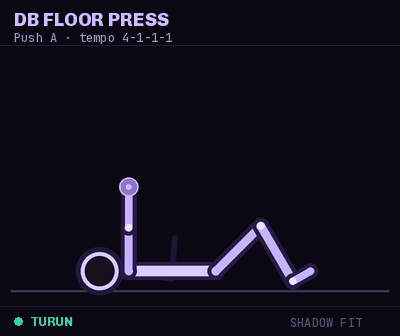

**DB Lateral Raise**  
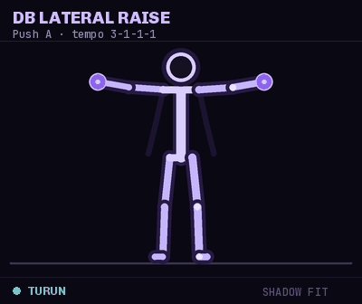

**DB Squeeze Floor Press**  
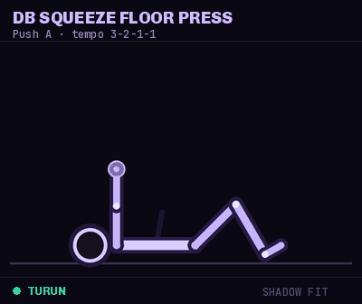

**Diamond Push-Up**  
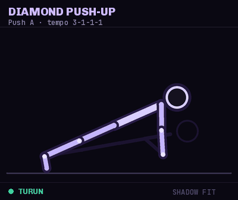

**One-Arm DB Overhead Triceps Extension**  
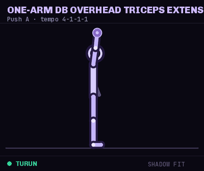

**Standing DB Shoulder Press**  
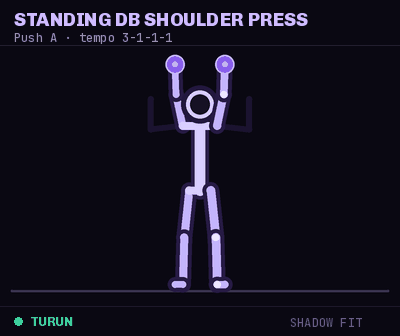

## Selasa — Pull A

**DB Bicep Curl**  
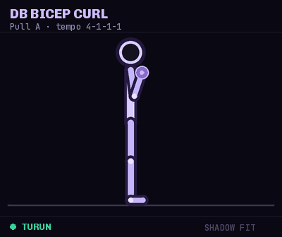

**DB Hammer Curl**  
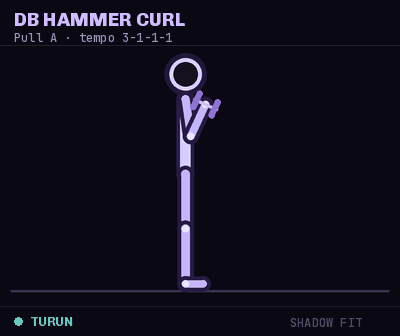

**DB Renegade Row**  
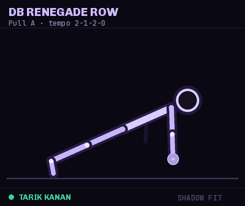

**DB Reverse Fly**  
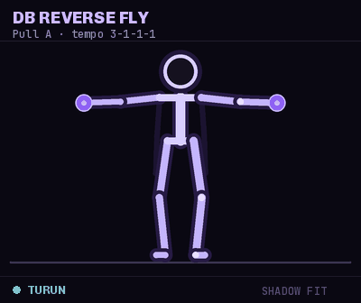

**One-Arm DB Row**  
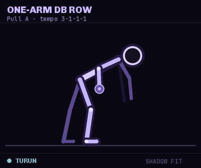

**Superman Pull**  
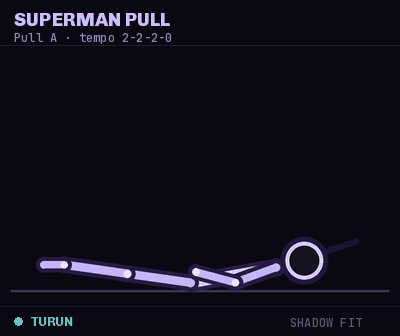

## Rabu — Leg A

**DB Bulgarian Split Squat**  
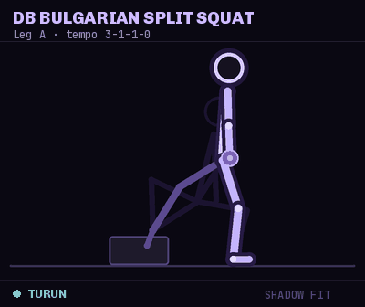

**DB Goblet Squat**  
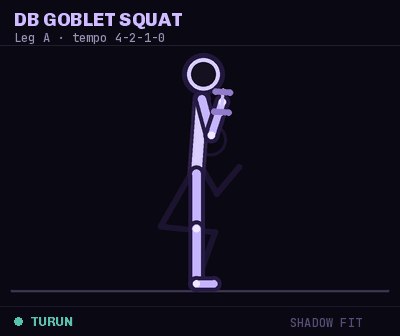

**DB Romanian Deadlift**  
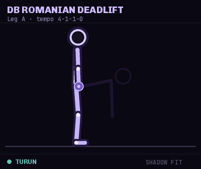

**DB Standing Calf Raise**  
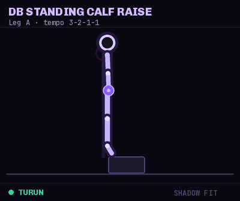

**Plank**  
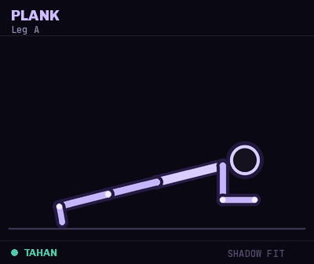

**Single-Leg Glute Bridge**  
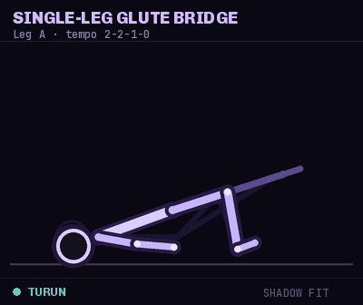

## Kamis — Push B

**Close-Grip Push-Up**  
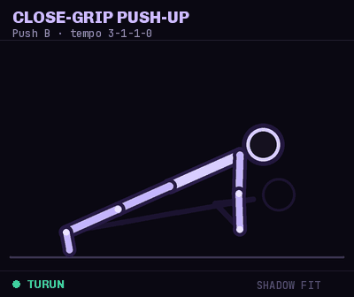

**DB Arnold Press**  
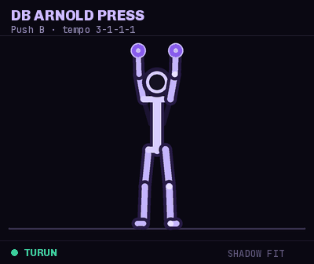

**DB Floor Fly**  
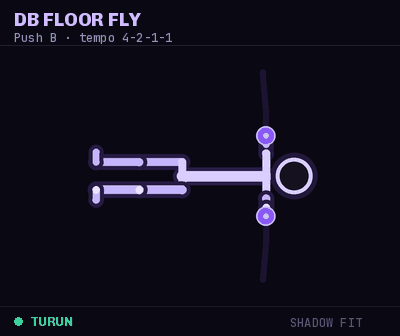

**DB Triceps Kickback**  
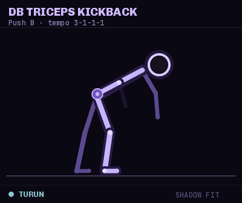

**Feet-Elevated Push-Up**  
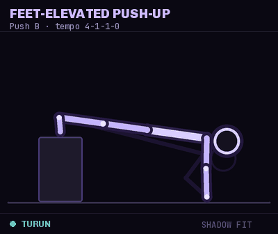

**Pike Push-Up**  
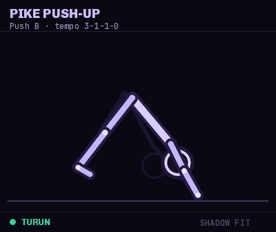

## Jumat — Pull B

**DB Bent-Over Row**  
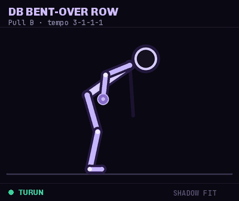

**DB Concentration Curl**  
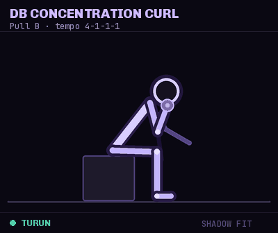

**DB Pullover**  
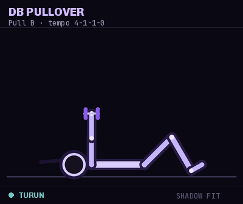

**DB Zottman Curl**  
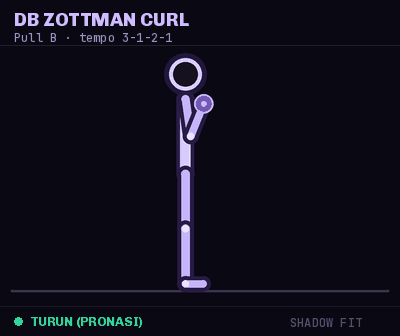

**Prone Y-T-W Raise**  
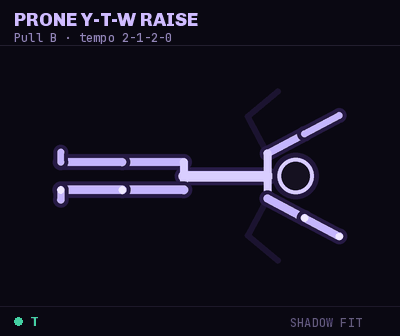

**Superman Hold + Row**  
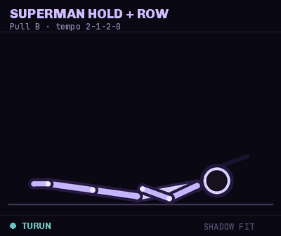

## Sabtu — Leg B

**DB Hip Thrust**  
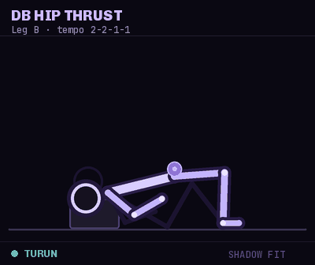

**DB Reverse Lunge**  
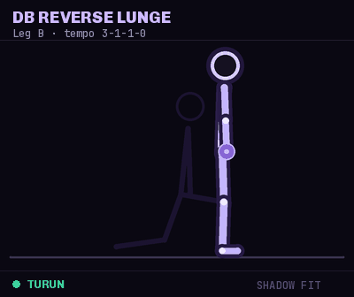

**DB Step-Up**  
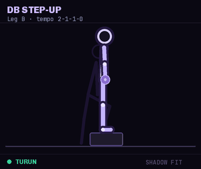

**Hollow Body Hold**  
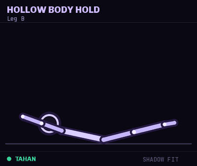

**Single-Leg Calf Raise**  
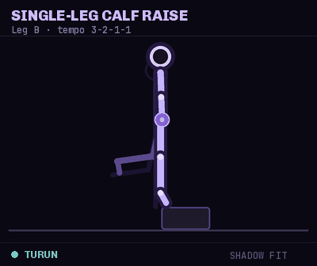

**Single-Leg RDL**  
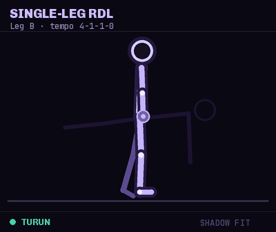

